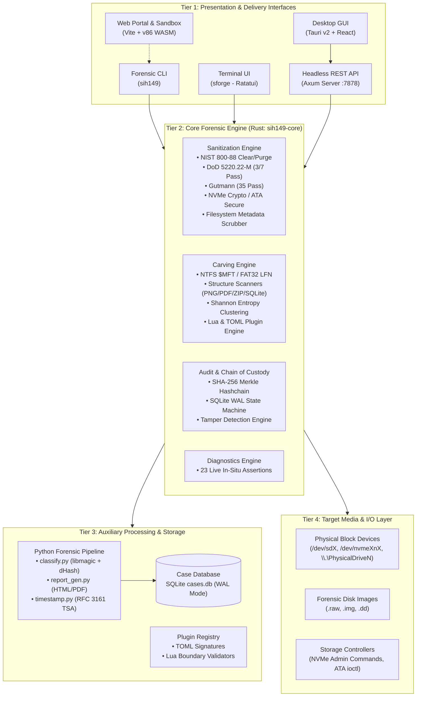

# RAZE-CARVE: Universal Forensic Data Sanitization, Deep Recovery & Cryptographic Certification Platform

**Project Documentation & System Engineering Reference Manual**  
*Built for Smart India Hackathon (SIH-149) — National Cybersecurity & Cyberforensics Track*  
*Standard Compliance: NIST SP 800-88 Rev 1 | DoD 5220.22-M | RFC 3161*

---

## Table of Contents
1. [Executive Summary & Problem Statement](#1-executive-summary--problem-statement)
2. [Complete System Architecture](#2-complete-system-architecture)
3. [Rust Core Engine (`crates/sih149-core`)](#3-rust-core-engine-cratessih149-core)
   - 3.1 [Data Sanitization Subsystem (`wiper/`)](#31-data-sanitization-subsystem-wiper)
   - 3.2 [Forensic File Carving Subsystem (`carver/`)](#32-forensic-file-carving-subsystem-carver)
   - 3.3 [Shannon Entropy Profiling & Clustering](#33-shannon-entropy-profiling--clustering)
   - 3.4 [Cryptographic Audit Log & Merkle Hashchain (`audit/`, `db/`)](#34-cryptographic-audit-log--merkle-hashchain-audit-db)
   - 3.5 [Diagnostics & In-Situ Assertions (`diagnostics.rs`)](#35-diagnostics--in-situ-assertions-diagnosticsrs)
4. [User Interfaces & Delivery Modes](#4-user-interfaces--delivery-modes)
   - 4.1 [Forensic CLI (`crates/sih149-cli`)](#41-forensic-cli-cratessih149-cli)
   - 4.2 [Terminal User Interface (`crates/sih149-tui`)](#42-terminal-user-interface-cratessih149-tui)
   - 4.3 [Desktop GUI & Axum REST Server (`src-tauri` + `src-ui`)](#43-desktop-gui--axum-rest-server-src-tauri--src-ui)
   - 4.4 [Web Portal & WASM Sandbox (`website/`)](#44-web-portal--wasm-sandbox-website)
5. [Python Forensic Pipeline (`pipeline/`)](#5-python-forensic-pipeline-pipeline)
6. [Extensibility: Plugins & Custom Signatures](#6-extensibility-plugins--custom-signatures)
7. [Safety Architecture & Fail-Safe Defenses](#7-safety-architecture--fail-safe-defenses)
8. [Testing Suite & Quality Assurance](#8-testing-suite--quality-assurance)
9. [Deployment: Native, Live ISO, and Docker](#9-deployment-native-live-iso-and-docker)
10. [Command-Line & API Reference](#10-command-line--api-reference)

---

## 1. Executive Summary & Problem Statement

### 1.1 The Forensic Challenge
Modern cybersecurity and digital forensics face two opposing, critical dilemmas:
1. **The Sanitization Blindspot**: Traditional software wipers (`dd`, simple file deletion) operate above the storage controller. They are completely incapable of addressing the 10–25% overprovisioned NAND flash cells, wear-leveling reserves, and reallocated bad sectors managed by modern SSD Flash Translation Layers (FTL). This leaves recoverable forensic data behind on retired enterprise hardware.
2. **The Carving Inefficiency**: Naive file carvers rely on magic-byte headers and scrape arbitrary sector blocks until a presumed length is reached. This produces corrupted evidence, broken container hierarchies (ZIP, PDF, SQLite), and false positives in high-entropy sectors.
3. **Chain-of-Custody Fragility**: Forensic logs written to plain text or standard relational databases can be trivially tampered with or modified. In legal contexts, unverified timestamps fail court admissibility standards.

### 1.2 The RAZE-CARVE Solution
**RAZE-CARVE** is an open-source, unified forensic platform written in memory-safe **Rust** with an auxiliary Python pipeline and multi-modal interfaces. It replaces commercial forensic software suites costing \$3,000–\$50,000/year by providing:
* **Hardware-level controller sanitization** (NVMe Cryptographic Erase, ATA Enhanced Secure Erase) alongside standard multi-pass magnetic wiping (DoD 5220.22-M, Gutmann 35-pass).
* **Deep structure-aware file carving** that parses internal format chunk boundaries, validates checksums, and reconstructs filesystem metadata (NTFS `$MFT` USA fixup, FAT32 VFAT LFN chains).
* **Mathematical Shannon entropy scanning** ($0.000$ to $7.999$ bits/byte) with 3-block moving-average smoothing to distinguish ciphertext, compressed streams, and sparse padding.
* **Tamper-evident SHA-256 Merkle hashchain audit logging** linked to RFC 3161 cryptographic timestamps for court-admissible proof of existence.

---

## 2. Complete System Architecture

RAZE-CARVE is architected in a modular, 4-tier layer structure ensuring separation of concerns, high throughput, and safety:



---

## 3. Rust Core Engine (`crates/sih149-core`)

The core engine is implemented with zero garbage collection pauses and strict memory safety guarantees.

### 3.1 Data Sanitization Subsystem (`wiper/`)

#### A. Multi-Pass Software Sanitization Algorithms
* **Zero Fill (1-pass)**: Writes `0x00` across all sectors.
* **Ones Fill (1-pass)**: Writes `0xFF` across all sectors.
* **Random Fill (1-pass)**: Writes cryptographically secure pseudorandom bytes generated via ChaCha20.
* **DoD 5220.22-M (3-pass)**:
  - Pass 1: Fixed character pattern (`0x00`).
  - Pass 2: Complement bitwise pattern (`0xFF`).
  - Pass 3: Random cryptographic byte sequence.
* **DoD 5220.22-M ECE (7-pass)**:
  - Alternates 7 passes of fixed characters, complements, and pseudo-random byte sequences.
* **Gutmann Method (35-pass)**:
  - Designed by Peter Gutmann for magnetic media. Executes 4 random passes, 27 specific magnetic flux transition pattern passes (targeting MFM/RLL encoding schemes), and 4 final random passes.

#### B. Controller-Level Firmware Erasure (Hardware Silicon Sanitization)
Overcoming the Flash Translation Layer (FTL) blindspot on solid-state media:
* **NVMe Cryptographic Erase**: Sends an NVMe `Format NVM` admin command with Cryptographic Erase attributes. The SSD controller immediately drops and regenerates its internal AES media encryption key, rendering all underlying NAND cells cryptographically unrecoverable within milliseconds.
* **NVMe Block Erase**: Triggers a low-level electrical flash block erase across all physical NAND channels, including overprovisioned reserves and wear-leveling blocks.
* **ATA Secure Erase & Enhanced Secure Erase**: Communicates directly with SATA/IDE controllers via `ioctl` (SG_IO passthrough) or `hdparm` to execute internal firmware wiping routines.

#### C. In-Place Filesystem-Aware Metadata Scrubbing (`wiper::metadata/`)
Standard file shredding often leaves directory tables and inode records intact. SecureForge scrubs filesystem structures directly:
* **NTFS Master File Table (`ntfs.rs`)**:
  - Scans 1024-byte `$MFT` records.
  - Overwrites resident `$DATA` payloads.
  - Neutralizes `$FILE_NAME` timestamps and non-resident cluster runlists.
  - Stamps records with `b"BAAD"` magic to corrupt forensic carving attempts.
* **FAT/FAT32 Directory Tables (`fat.rs`)**:
  - Locates 32-byte directory entries and overwrites the initial byte with `0xE5` (deletion marker).
  - Clears timestamps, cluster pointers, and file size fields while maintaining directory traversal integrity.
  - Executes `scrub_fat32_chain_entry` to zero out allocation links in the File Allocation Table.
* **ext4 Inode & Directory Scrubbing (`ext4.rs`)**:
  - Zeros out ext4 inodes (including extent tree `0xF30A` headers, block pointers, timestamps, and extended attributes).
  - Rewrites directory entries (`scrub_ext4_dir_entry`) by unlinking inode pointers while preserving the record length chain.

#### D. Verification Protocol (`verify_wipe.rs`)
To verify erasure without introducing unnecessary drive wear:
* **Deterministic Passes**: Compares sample blocks against expected byte constants.
* **Random Passes**: Re-evaluates sampled blocks against the deterministic seeded PRNG stream used during the wipe.
* **Mandatory Tail Boundary Check**: Samples 0% (head), intermediate percentiles, and the **final addressable tail boundary** of the media to ensure secondary GPT backup partition tables and volume slack are inspected.

---

### 3.2 Forensic File Carving Subsystem (`carver/`)

The carver uses a multi-phase structural extraction pipeline:

```text
Raw Sector Stream ──▶ [ Phase 1: FS Record Parser ] ──▶ Inode / Directory Extraction
                   ──▶ [ Phase 2: Signature Scanner ] ──▶ Magic Byte Detection (SOI, IHDR, etc.)
                   ──▶ [ Phase 3: Structure Trimmer ] ──▶ Internal Chunk / Trailer Validation
                   ──▶ [ Phase 4: Entropy Profiler ]  ──▶ Cluster Continuity Verification
```

#### Phase 1: Filesystem Metadata & Inode Carving (`filesystem_records.rs`)
* **NTFS `$MFT` Inodes**:
  - Detects sector-aligned 1024-byte records starting with `FILE`.
  - **USA Fixup Unapplication**: Replaces the sector tail bytes (bytes 510-511 and 1022-1023) with the original values preserved in the Update Sequence Array.
  - Parses attributes: `$STANDARD_INFORMATION` (0x10), `$FILE_NAME` (0x30, prioritizing Win32 long names over 8.3 aliases), and `$DATA` (0x80).
  - Handles both **resident data** (stored directly inside the record) and **non-resident data** (decodes packed runlists into relative signed LCN cluster pointers).
* **FAT32 VFAT Long File Name Reconstruction**:
  - Reassembles multi-part reverse-order LFN entries (`attr == 0x0F`), validates 8.3 checksum bytes, and recovers deleted entries.

#### Phase 2 & 3: Format-Aware Boundary Trimming (`structure/`)
Prevents over-carving (saving gigabytes of junk after a file) by understanding format specifications:
* **PNG**: Parses 8-byte signature (`89 50 4E 47 0D 0A 1A 0A`). Sequentially reads 4-byte chunk lengths, 4-byte chunk types, chunk data, and 4-byte CRC-32 checksums. Stops exactly at the `IEND` chunk.
* **JPEG**: Validates Start of Image (`FF D8`), parses Exif markers, Quantization Tables (DQT), Start of Scan (SOS), and truncates at End of Image (`FF D9`).
* **PDF**: Scans for `%PDF-`, extracts `/Root` catalogs, cross-reference tables (`xref`), and terminates at `%%EOF` trailers.
* **ZIP & Office Containers (`.docx`, `.xlsx`, `.pptx`, `.apk`, `.jar`)**: Locates End of Central Directory (EOCD) records (`50 4B 05 06`), reads the central directory offset and length, and computes the exact container boundary.
* **SQLite Databases (`.sqlite`, `.db`)**: Reads header page size (512B to 64KB), extracts the page count from byte offset 28, validates B-tree page types, and truncates before trailing unallocated space.

---

### 3.3 Shannon Entropy Profiling & Clustering

Shannon Entropy measures the information density and randomness of a byte stream:

$$H(X) = -\sum_{i=0}^{255} P(x_i) \log_2 P(x_i)$$

Where $P(x_i)$ is the probability of byte value $i$ occurring in the block.
* $H = 0.000$ bits/byte: Completely uniform data (e.g., all `0x00` or all `0xFF`).
* $H \approx 3.5 - 5.0$ bits/byte: Structured ASCII text, source code, JSON, logs.
* $H \approx 5.8 - 7.2$ bits/byte: Compiled x86/ARM executables, ELF/PE binaries.
* $H \approx 7.5 - 8.0$ bits/byte: High-entropy encrypted blocks (LUKS, BitLocker) or compressed archives (gzip, zstd, JPEG).

#### Smoothing & Clustering Engine (`entropy_clustering.rs`)
* **Centered Moving-Window Smoothing**: Implements a 3-block moving-average filter (`cluster_entropy_streams_smoothed`) to bridge transient micro-dips (such as null-padded section headers inside an encrypted container) without fragmenting contiguous evidence streams.
* **Intra-Cluster Variance Metric**: Computes the variance ($\sigma^2$) across blocks to differentiate uniform ciphertext from variable-entropy media streams.
* **Sparse Zero-Block Run Consolidation**: Maps contiguous runs of zeroed blocks via `find_zero_block_runs` to accurately identify file slack and unallocated holes.

---

### 3.4 Cryptographic Audit Log & Merkle Hashchain (`audit/`, `db/`)

To guarantee that case actions cannot be repudiated or modified post-investigation:
* **Genesis Hash**:
  $$\text{Hash}_0 = \text{SHA-256}(\text{case\_id} \parallel \text{investigator} \parallel \text{target} \parallel \text{timestamp})$$
* **Chained Entry Hash**:
  $$\text{Hash}_n = \text{SHA-256}(\text{Hash}_{n-1} \parallel \text{sequence\_id} \parallel \text{event\_type} \parallel \text{payload\_json})$$

#### Tamper Detection Mechanism (`CaseDatabase::get_verified_hashchain`)
Stored inside SQLite in Write-Ahead Logging (WAL) mode:
1. Iterates from the genesis block through all recorded case events.
2. Recomputes the SHA-256 digest at every step.
3. If any database record was modified, deleted, or inserted out of order, the hashchain breaks immediately, pointing to the exact compromised record sequence ID.

---

### 3.5 Diagnostics & In-Situ Assertions (`diagnostics.rs`)

RAZE-CARVE includes an internal self-test engine with **23 live assertions** verifying:
* Wiper pattern generators (Zero, Ones, DoD, Gutmann).
* Carving signature lookups and boundary trimmers.
* SHA-256 hashing and Merkle chain math.
* SQLite database consistency and WAL mode operations.
* System I/O permissions and block-device safety gates.

---

## 4. User Interfaces & Delivery Modes

RAZE-CARVE provides four synchronized presentation layers:

### 4.1 Forensic CLI (`crates/sih149-cli`)
Engineered for head-to-head scripting, headless triage, and CI/CD pipelines.

* **Binary**: `sih149`
* **Core Commands**:
  - `demo`: Autonomous demonstration that synthesizes a disk image with hidden files, carves evidence, verifies hashes, and generates a PDF certificate.
  - `test`: Executes all 23 in-situ diagnostic assertions.
  - `info`: Discovers attached block devices, partitions, mountpoints, serials, and SMART metrics.
  - `wipe`: Multi-pass block device sanitization (`zero`, `random`, `dod3`, `dod7`, `gutmann`).
  - `shred`: Multi-pass file/directory shredding with random inode renames and slack wiping.
  - `recover`: Deep structure-aware file carving from disks or `.img`/`.raw` files.
  - `firmware-erase`: NVMe Cryptographic Erase and ATA Enhanced Secure Erase.
  - `report`: Case management and audit export.

---

### 4.2 Terminal User Interface (`crates/sih149-tui`)
Built with **Ratatui** and **Crossterm** for air-gapped environments, serial consoles, and emergency rescue disks without X11 or Wayland.

* **Binary**: `sforge`
* **Navigation Map**:
  - <kbd>F1</kbd> **Mission Dashboard**: Real-time overview of drive attachments, live audit logs, and memory consumption.
  - <kbd>F2</kbd> **Drive Manager**: Interactive storage device selector with SMART telemetry.
  - <kbd>F3</kbd> **Entropy Heatmap**: Sector randomness visualization ($0.0 - 8.0$ b/B) rendered in terminal ANSI color gradients.
  - <kbd>F4</kbd> **Sanitize Wizard**: Algorithm selection, verification toggles, and pass-count parameters.
  - <kbd>F5</kbd> **Forensic Carver**: Interactive carving session manager with confidence threshold sliders.
  - <kbd>F6</kbd> **Self-Test Engine**: Real-time diagnostic assertion inspector showing latency and status.
  - <kbd>F7</kbd> **Help & Reference**: Built-in compliance standards and keyboard shortcuts.

---

### 4.3 Desktop GUI & Axum REST Server (`src-tauri` + `src-ui`)

#### Native Desktop App (Tauri v2)
* Integrates a React 18 + TypeScript frontend with the Rust native core via Tauri v2 IPC commands.
* Uses **Tailwind CSS**, **TanStack Table** for high-performance artifact browsing, and **Recharts** for real-time entropy and sanitization throughput charts.

#### Headless REST Server Mode
When deployed on a central forensic laboratory server:
```bash
./target/release/secureforge-desktop --server --host 0.0.0.0 --port 7878 --api-token "secret"
```
* Exposes an **Axum HTTP REST API** protected by Bearer Token authentication:
  - `GET /health`: Public status check.
  - `GET /api/drives`: Enumerates physical disks with SMART telemetry.
  - `POST /api/wipe`: Launches an asynchronous block-level wipe job.
  - `POST /api/shred`: Launches a file/directory shred job.
  - `POST /api/scan`: Launches a background carving job.
  - `POST /api/entropy`: Returns chunked Shannon entropy for visual plotting.
  - `POST /api/hex`: Returns hex and ASCII dumps of physical disk sectors.
  - `GET /api/diagnostics`: Executes live in-situ assertions.

---

### 4.4 Web Portal & WASM Sandbox (`website/`)

* **Frontend**: React 18, TypeScript, Tailwind CSS, Vite 7.
* **WASM x86 Sandbox**: Employs `v86` to run an interactive terminal emulator in the browser, allowing prospective users to test the CLI safely in an emulated virtual machine.
* **Public Access**: Ready for deployment on static hosting or via **Cloudflare Quick Tunnels** (`cloudflared`) for instant, zero-trust remote previews.

---

## 5. Python Forensic Pipeline (`pipeline/`)

Located in `pipeline/`, these workers handle post-processing, cryptographic timestamping, and reporting:

1. **Cryptographic Certificate Generator (`report_gen.py`)**:
   - Compiles audit records into forensic certificates (HTML & PDF via WeasyPrint).
   - Enforces strict context escaping against template injection vulnerabilities.
   - Embeds the cryptographic hashchain and RFC 3161 timestamp tokens.
2. **File Classifier (`classify.py`)**:
   - Inspects carved files using `libmagic` to verify true MIME types.
   - Extracts EXIF metadata (GPS coordinates, camera serials, timestamps).
   - Computes perceptual difference hashes (**dHash**) to cluster visually similar images even if compressed or modified.
3. **RFC 3161 Timestamping Client (`timestamp.py`)**:
   - Handshakes with public or private Time-Stamp Authorities (TSAs) (e.g., DigiCert, Sectigo).
   - Submits the SHA-256 digest of the case audit report and receives a signed, court-admissible `.tsr` (Time-Stamp Response) token proving that the erasure or recovery occurred at an exact certified time.

---

## 6. Extensibility: Plugins & Custom Signatures

RAZE-CARVE allows forensic examiners to define custom file signatures and validation rules without modifying or recompiling the Rust codebase.

### 6.1 TOML Signature Definitions (`plugins/signatures/`)
Examiners can add proprietary file headers and footers using declarative TOML:
```toml
[signature]
name = "custom_evidence"
extension = "dat"
header = [0x43, 0x55, 0x53, 0x54] # "CUST"
footer = [0x45, 0x4E, 0x44, 0x21] # "END!"
max_size = 10485760               # 10 MB
min_confidence = 75
```

### 6.2 Dynamic Lua Validation Scripts (`plugins/scripts/`)
For formats requiring deep structural validation (e.g., parsing internal headers or verifying internal checksums):
* RAZE-CARVE integrates `mlua` (Lua 5.4 runtime).
* Lua scripts receive the raw carved byte buffer, evaluate internal structures, and return a confidence score ($0 - 100$) and exact EOF boundary.

---

## 7. Safety Architecture & Fail-Safe Defenses

To eliminate the risk of accidental data loss during high-stress incident triage:

1. **Boot Device Lockdown**:
   - The wiper parses `/proc/mounts`, `/sys/block`, and Windows volume mount points.
   - Any physical or logical drive containing `/`, `/boot`, `/home`, active swap space, or the Windows System partition (`C:\`) is **strictly locked**. Operations abort immediately with an unskippable safety error.
2. **Path Traversal Sanitization**:
   - All input paths are normalized and checked with `O_NOFOLLOW` / `symlink_metadata` to prevent symlink traversal attacks targeting system configuration files.
3. **Copy-on-Write (CoW) Filesystem Guard**:
   - Detects Btrfs, ZFS, and APFS filesystems via magic numbers.
   - Refuses file-level shredding on CoW media because overwriting a block allocates a new block, leaving historical snapshots intact on disk. Directs the operator to block-level media erasure instead.

---

## 8. Testing Suite & Quality Assurance

RAZE-CARVE maintains a comprehensive, zero-warning test suite with **202 automated tests**:

```bash
# 1. Rust Workspace Unit & Integration Tests (181 tests)
cargo test --workspace

# 2. Python Forensic Pipeline Tests (16 tests)
python3 pipeline/test_pipeline.py

# 3. Web UI Workstation Tests (5 tests)
cd src-ui && npm test
```

### Test Coverage Highlights:
* Multi-pass wiper pattern bit-exactness.
* Carver recovery of corrupted and fragmented JPEG, PNG, PDF, and ZIP streams.
* Merkle hashchain tamper detection and row-deletion detection.
* NTFS USA fixup unapplication and FAT32 LFN reconstruction.
* Shannon entropy variance accuracy across known entropy streams.

---

## 9. Deployment: Native, Live ISO, and Docker

### 9.1 Native Compilation
```bash
# Build Rust binaries with maximum optimizations
cargo build --release -p sih149-cli -p sih149-tui -p secureforge-desktop

# Build React UI
npm --prefix src-ui install && npm --prefix src-ui run build
```
Outputs:
* `target/release/sih149` (CLI binary ~5.4 MB)
* `target/release/sforge` (TUI binary ~4.5 MB)
* `target/release/secureforge-desktop` (Desktop & REST server ~20 MB)

### 9.2 Universal Docker Deployment
Zero-setup deployment across Windows, macOS, and Linux:
```bash
# 1. Launch Web GUI Mode (http://localhost:7878)
docker compose up gui

# 2. Launch Interactive Terminal UI
docker compose run --rm tui

# 3. Launch Forensic Scripting CLI
docker compose run --rm cli info
```

### 9.3 Bootable Live ISO (`iso/`)
* Contains build manifests to construct a Debian-based, air-gapped, bootable USB live rescue environment.
* Boots directly into the Ratatui TUI (`sforge`) on tty1 with kernel write-blocking flags enabled for field triage.

---

## 10. Command-Line & API Reference

### 10.1 CLI Cheat Sheet (`sih149`)

```bash
# 1. Run full automated self-test demo with PDF certificate:
sih149 demo --output-dir ./demo_output

# 2. Run in-situ system diagnostics:
sih149 test --json

# 3. Inspect attached block devices:
sudo sih149 info --device /dev/sdb

# 4. Shred sensitive file with 7 passes and slack wiping:
sih149 shred --target ./case_evidence.raw --passes 7 --scrub-slack --yes

# 5. Carve specific file types with 60% confidence:
sudo sih149 recover --source /dev/sdb --output ./recovered --types jpg,png,pdf,zip --min-confidence 60

# 6. Sanitize drive using DoD 5220.22-M 3-pass with verification:
sudo sih149 wipe --device /dev/sdb --method dod3 --verify

# 7. Hardware NVMe Cryptographic Erase:
sudo sih149 firmware-erase --device /dev/nvme0n1 --method nvme-crypto --expert
```

### 10.2 REST API Specification (Port 7878)

| Endpoint | Method | Headers | Description |
| :--- | :--- | :--- | :--- |
| `/health` | `GET` | None | Public health check returning `{ "status": "ok" }` |
| `/api/drives` | `GET` | `Authorization: Bearer <TOKEN>` | Enumerates block devices, partitions, and SMART status |
| `/api/wipe` | `POST` | `Authorization: Bearer <TOKEN>` | Body: `{ "device": "/dev/sdb", "method": "dod3" }` |
| `/api/shred` | `POST` | `Authorization: Bearer <TOKEN>` | Body: `{ "path": "/path", "passes": 3 }` |
| `/api/scan` | `POST` | `Authorization: Bearer <TOKEN>` | Body: `{ "source": "/dev/sdb", "types": ["pdf"] }` |
| `/api/entropy`| `POST` | `Authorization: Bearer <TOKEN>` | Body: `{ "device": "/dev/sdb", "chunk_size": 4096 }` |
| `/api/hex` | `POST` | `Authorization: Bearer <TOKEN>` | Body: `{ "device": "/dev/sdb", "offset": 0, "length": 512 }` |

---

*RAZE-CARVE System Documentation — Open-Source Forensic Engineering.*
