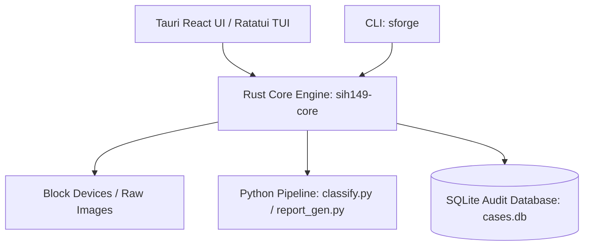

# SecureForge Technical Documentation

## 1. Architecture Overview
SecureForge employs a 4-layer forensic-grade architecture designed for data sanitization and structure-aware data recovery:
1. **User Interfaces:**
   - Desktop GUI: Tauri v2 desktop application with React TypeScript frontend.
   - Terminal UI: Interactive Ratatui TUI with live status, drive heatmaps, and progress cancellation.
   - CLI: Command-line interface (`sforge`) for automated and scripted forensic pipelines.
2. **Core Engine (`sih149-core`, Rust):**
   - Read-only evidence access for block devices and raw images (`DiskSource`, `BlockDevice`, `RawImage`). Genuine E01 images are detected and rejected because no complete EWF decoder is bundled.
   - Structure-aware file carving engine and filesystem record parser (NTFS `$MFT`, FAT32 VFAT LFN).
   - Sanitization engine (NIST SP 800-88 Rev. 1, DoD 5220.22-M, Gutmann 35-pass, NVMe Crypto Erase, ATA Secure Erase).
   - Linear SHA-256 cryptographic hashchain audit log. Timestamp token validation is not implemented.
3. **Pipeline Workers (Python):**
   - High-throughput file classifier (`classify.py`) utilizing magic bytes and perceptual image hashing (`dHash`).
   - PDF/HTML case report generator (`report_gen.py`).
4. **Database & Audit Storage (SQLite):**
   - Local case database (`CaseDatabase`) storing cases, carved artifacts, and hashchain audit entries.

---

## 2. Forensic File Carving Engine

### 2.1 Multi-Phase Carving Pipeline
The carving engine (`CarvingEngine`) operates across four distinct phases:
1. **Filesystem Metadata & Inode Carving (`filesystem_records.rs`):**
   - **NTFS `$MFT` Inodes:** Scans 512-byte sector-aligned boundaries for 1024-byte MFT records.
     - *Fixup Unapplication:* Unapplies the NTFS Update Sequence Array (USA), restoring original sector tail bytes (bytes 510-511 and 1022-1023) overwritten by the Update Sequence Number (USN).
     - *Attribute Extraction:* Parses `$STANDARD_INFORMATION` (0x10) timestamps, `$FILE_NAME` (0x30) Unicode filenames (prioritizing Win32 over DOS 8.3 aliases), and `$DATA` (0x80).
     - *Resident vs Non-Resident Handling:* Extracts resident file payloads directly from the record. For non-resident streams, decodes packed data runs into structured `cluster_pointers` with signed relative LCN deltas.
   - **FAT/FAT32 Directory Entries:** Scans 32-byte records for deleted entries (`0xE5`).
     - *VFAT Long File Name (LFN) Reconstruction:* Reassembles multi-part reverse-order LFN entries (`attr == 0x0F`), validates Microsoft 8.3 checksums, and restores deleted first characters.
2. **Signature Sector Scanner (`scanner.rs`, `signatures.rs`):**
   - Scans evidence at sector boundaries using a centralized canonical catalog (`SignatureDatabase::builtin()`).
   - Supports runtime TOML definitions (`plugins/signatures/`) and dynamic Lua script validators (`plugins/scripts/`).
3. **Format-Aware Boundary Trimming (`structure/`):**
   - Prioritizes deep structural headers over naive footers to prevent trailing slack over-carving:
     - **PNG:** Traverses PNG chunks, validates CRC-32 checksums, and stops at `IEND`.
     - **JPEG:** Parses Exif metadata, SOS (Start of Scan), DQT markers, and truncates at `FF D9`.
     - **PDF:** Locates `%%EOF` trailers, cross-reference tables (`xref`), and `/Info` metadata dictionaries.
     - **ZIP & Compound Documents (`docx`, `xlsx`, `pptx`, `apk`, `jar`):** Parses End of Central Directory (EOCD) records and Central Directory entries to extract exact container sizes.
     - **SQLite Databases (`sqlite`, `db`, `sqlite3`):** Reads page sizes (512B to 64KB) and in-header page counts, verifying contiguous B-tree leaf/interior pages and truncating before zeroed slack.
4. **Shannon Entropy Profiling & Stream Clustering (`entropy_clustering.rs`):**
   - Clusters contiguous blocks into entropy categories: Compressed/Encrypted (7.20-8.00), Binary Executable (5.80-7.20), Structured Text (3.20-5.80), and Sparse Padding (0.00-1.50).
   - **Centered Moving-Window Smoothing:** Employs a 3-block moving-average filter (`cluster_entropy_streams_smoothed`) to bridge transient micro-dips (e.g. metadata tables or symbol headers) without artificially fragmenting contiguous streams into disjoint clusters.
   - **Intra-Cluster Variance Metric:** Computes entropy variance (`variance`) across blocks to distinguish uniform ciphertext from variable-entropy compressed streams.
   - **Sparse Zero-Block Run Consolidation:** Detects and consolidates contiguous runs of zero-filled blocks via `find_zero_block_runs` to accurately map sparse holes and unallocated cluster slack.

---

## 3. Sanitization & Verification Engine

### 3.1 Sanitization Algorithms
SecureForge provides software overwriting and firmware-level hardware erasure:
- **Zero Fill (1 pass):** Overwrites all addressable blocks with `0x00`.
- **Ones Fill (1 pass):** Overwrites all addressable blocks with `0xFF`.
- **DoD 5220.22-M (3 passes):** Pass 1: Fixed pattern (`0x00`), Pass 2: Complement (`0xFF`), Pass 3: Cryptographic PRNG stream.
- **DoD 5220.22-M ECE (7 passes):** Seven alternating fixed, complement, and pseudo-random passes.
- **Gutmann (35 passes):** Peter Gutmann's algorithm for legacy MFM/RLL and modern magnetic media.
- **NVMe Cryptographic Erase:** Sends NVMe `Format NVM` admin commands with Crypto Erase setting, destroying the internal encryption key in < 1 second.
- **ATA Secure Erase / Enhanced Secure Erase:** Issues ATA security commands via `hdparm` / `ioctl` passthrough.

### 3.2 Verification Protocol (`verify_wipe.rs`)
The implementation samples the final written pattern; it does not issue a compliance certification:
- **Deterministic Passes:** Performs byte-level comparison against expected pass patterns.
- **Random Passes:** Compares sampled bytes with the exact keyed byte stream generated during the write pass.
- **Mandatory Tail Boundary Check:** Under sampled verification (< 100%), the verification loop explicitly samples the beginning of media, interior blocks, and the **final addressable tail boundary** of the disk. This guarantees that secondary GPT backup headers and volume slack at the end of the media are inspected.

### 3.3 Copy-on-Write (CoW) Filesystem Defenses
Overwriting files on CoW filesystems (Btrfs, ZFS, APFS) allocates new physical blocks rather than destroying historical snapshots. SecureForge:
- Detects CoW filesystems via filesystem magic numbers (`0x9123683E` for Btrfs) with parent directory fallback.
- Refuses file shredding rather than reporting unverifiable coverage.

### 3.4 Filesystem-Aware Metadata Scrubbing (`wiper::metadata/`)
Standard block-level overwriting leaves residual metadata records in unallocated directory tables and inode entries. SecureForge implements in-place filesystem scrubbers:
- **NTFS Master File Table (`ntfs.rs`):** Identifies 1024-byte `$MFT` records, overwrites resident `$DATA` payload bytes, sanitizes `$FILE_NAME` timestamps/names and non-resident cluster runlists, and marks records with `b"BAAD"` to prevent carving.
- **FAT Directory Entries & Tables (`fat.rs`):** Overwrites 32-byte FAT/VFAT directory entries with `0xE5` deletion markers, zeroing filenames, timestamps, cluster addresses, and sizes while maintaining directory traversal integrity. Also provides `scrub_fat32_chain_entry` to clear FAT chain allocation links.
- **ext4 Inode & Directory Scrubbing (`ext4.rs`):** Zeros out ext4 inodes (including extent tree `0xF30A` headers, block pointers, timestamps, and extended attributes) and scrubs directory entries (`scrub_ext4_dir_entry`) by wiping inode pointers and filenames while preserving record length chains.
- **Unified Buffer Scrubber (`mod.rs`):** Scans unallocated buffers and applies multi-filesystem sanitization via `scrub_filesystem_metadata_buffer`.

---

## 4. Cryptographic Audit Log & Chain of Custody

### 4.1 SHA-256 Linear Hashchain
Every case maintains a strictly linear cryptographic hashchain (`HashChain`):
- `Genesis Hash = SHA-256(case_id || investigator || target || timestamp)`
- `Entry Hash = SHA-256(prev_hash || sequence_id || event_name || payload_json)`
- Guarantees append-only immutability.

### 4.2 SQLite Row Tamper Detection (`get_verified_hashchain`)
`CaseDatabase::get_verified_hashchain` verifies the cryptographic integrity of all audit entries:
- Validates that entry `N` correctly links to entry `N-1`.
- Detects database row modification, row deletion, and out-of-order insertions.

### 4.3 Timestamp Tokens
The report generator may include the hash of a supplied RFC 3161 token, but it does not validate signer trust, token status, or message imprint. Reports therefore explicitly mark supplied tokens as unverified and make no digital-signature or legal-admissibility claim.

---

## 5. Security & Privilege Model
- **Safety Gates:** Non-block targets, mounted devices, and devices related to system or boot mounts are rejected. There is no expert bypass for those guards.
- **Symlink Protection:** File shredding verifies `O_NOFOLLOW` / `symlink_metadata` to prevent symlink traversal attacks.
- **Write-Blocking:** Recovery operations open sources in read-only write-blocked mode.
